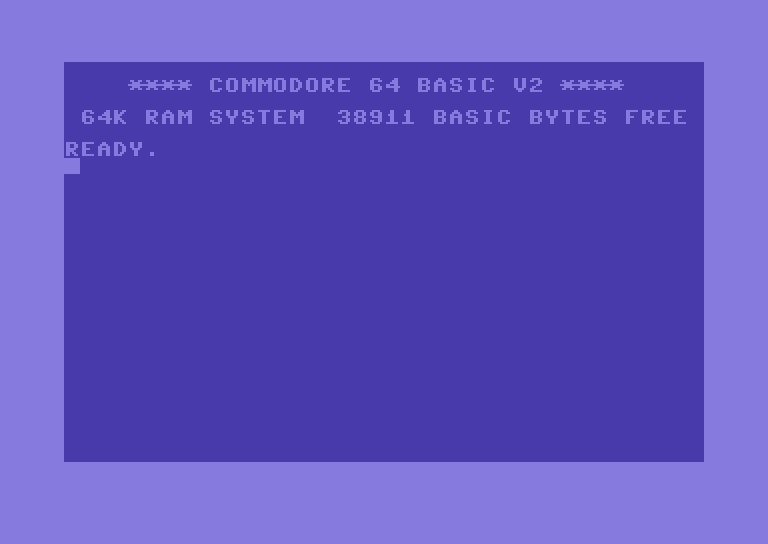
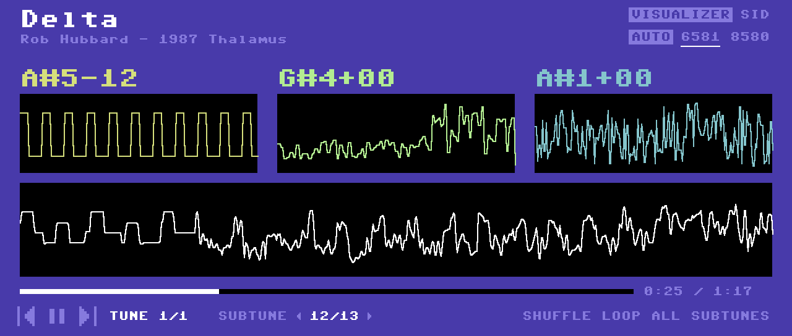
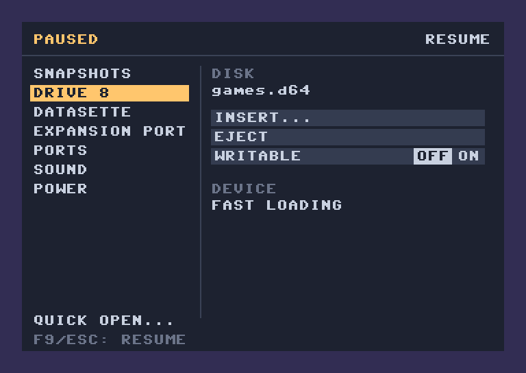

[](https://rubygems.org/gems/badline)
[](https://github.com/elektronaut/badline/actions/workflows/ci.yml)

# Badline



Badline is a Commodore 64 emulator written in Ruby. It emulates a PAL
or NTSC machine one clock cycle at a time, stepping the 6510, the VIC-II, both
CIAs and the SID together, so raster timing, bad lines and sprite DMA
are modelled at the cycle level.

It runs programs, disk and tape images, cartridges and SID tunes, and
the SDL2 front end supports the keyboard, joysticks, game controllers,
paddles and a 1351 mouse. It also runs the VIC-20, PAL or NTSC, as
`badline vic20`, the C128, in C128 mode on 40 or 80 columns and in C64 mode, as `badline c128`, the Plus/4, the C16 and the C116, as `badline plus4`, the PET and CBM, as `badline pet`, the CBM-II, the B series and the P500, as `badline cbm2`, and the MOS KIM-1, as `badline kim1`. See [What's emulated](#whats-emulated) for the details.

It comes in two builds of the same emulator:

- **`badline`**, compiled ahead of time with
  [Spinel](https://github.com/matz/spinel). It runs in real time with
  sound, so it's the one to play games with.
- **`badline-ruby`**, which comes with the Ruby gem and runs on CRuby. It
  runs slower than a real C64, so its sound is off by default. The gem is
  also a library, which runs a `Badline::C64` from Ruby without a
  window.

## Installation

The native `badline`, with Homebrew:

```sh
brew install elektronaut/tap/badline
```

It installs a prebuilt bottle on macOS 15 or newer on Apple Silicon and
on x86_64 Linux. Elsewhere the formula builds it from the release's
generated C, so it needs no Spinel or Ruby. To build it from a checkout
instead, see
[native/README.md](native/README.md).

The gem needs Ruby 4.0 or newer and the SDL2 library:

```sh
brew install sdl2           # macOS
apt install libsdl2-2.0-0   # Debian/Ubuntu
gem install badline
```

Or add `gem "badline"` to your Gemfile and run `bundle install`.

## Usage

Run `badline` with no arguments to boot to the BASIC prompt, or give it
something to load:

```sh
badline                # READY.
badline game.prg       # Load and run a program
badline game.d64       # Mount a disk image as device 8 and load it
badline game.tap       # Insert a tape and load it
badline game.crt       # Attach a cartridge
badline tune.sid       # Play a SID tune in the SID player
badline game.vsf       # Restore a snapshot, from badline or VICE
badline ~/c64          # Mount a directory as device 8
```

Programs, disk and tape images and SID tunes start automatically, and
a cartridge starts itself. A mounted directory waits for you to `LOAD`
from it.

The first argument can name the machine, as in `badline c64 game.prg`.
The C64 is the default, and `--model` picks which C64. See
[The VIC-20](#the-vic-20) for `badline vic20`, [The C128](#the-c128)
for `badline c128`, [The Plus/4](#the-plus4) for `badline plus4`,
[The PET](#the-pet) for `badline pet`, [The CBM-II](#the-cbm-ii) for
`badline cbm2` and [The KIM-1](#the-kim-1) for `badline kim1`.

`badline-ruby` takes the same media and the same options, with the
differences noted in the table. `--help` lists the options for either.

### Options

| Option | Effect |
| --- | --- |
| `--no-autostart` | Attach the media and stop at `READY.`, so you can type the `LOAD` yourself |
| `--writable` | Let the machine write to disk images. Without it, a disk goes in write-protected: the drive reports `26,WRITE PROTECT ON` for any write and the image file stays as it was |
| `--true-drive` | Put an emulated 1541 on device 8 instead of the KERNAL traps, a 1551 on the Plus/4, or a 2031 on the PET or the CBM-II, or for a `.d80` or `.d82` an 8050 or 8250. A `.d90` always goes in a D9060 or D9090. See [Media](#media) |
| `--drive-type MODEL` | On the Plus/4, `1541` makes the true drive on device 8 an emulated 1541 on the serial bus in place of the 1551. On the PET and the CBM-II, `2031` (the default), `8050`, `8250`, `1001` (an SFD-1001, which reads `.d82` images), `4040` or `3040` (two drives reading `.d64` images, with DOS 2.1), `2040` (DOS 1.2's `.d67` images), `9060` or `9090` names the drive `--true-drive` puts on the IEEE-488 bus. It implies `--true-drive`. See [The Plus/4](#the-plus4) and [The PET](#the-pet) |
| `-s`, `--subtune N` | Pick a subtune of a `.sid` file, counting from 1 |
| `--sid 6581`, `--sid 8580` | Fit the older or newer SID. `--sid auto`, the default, takes a `.sid` tune's own |
| `--ram SIZE` | Give a VIC-20 the RAM expansion `SIZE`: `unexpanded`, `3k`, `8k`, `16k`, `24k`, `32k` or `all`. Without it, the VIC-20 gets the expansion its media needs. See [The VIC-20](#the-vic-20). On the Plus/4, `16k`, `32k` or `64k` of RAM in place of the model's own, on the PET `4k`, `8k`, `16k` or `32k`, and on the KIM-1 `1k` (the default), `5k` or `expanded`. See [The KIM-1](#the-kim-1) |
| `--60hz` | Run a CRTC PET's 60 Hz editor in place of its 50 Hz one, or a CBM-II on 60 Hz mains. See [The PET](#the-pet) and [The CBM-II](#the-cbm-ii) |
| `--kernal 04a`, `--kernal 03b` | Fit a B series CBM-II with KERNAL 901244-04a (the default) or 901244-03b. The P500 takes its own, `02`. See [The CBM-II](#the-cbm-ii) |
| `--basic VERSION`, `--editor NAME` | Fit a PET with an upgrade ROM its board takes: BASIC `1`, `2` or `4`, or an editor. See [The PET](#the-pet) |
| `--c1lo FILE`, `--c1hi FILE`, `--c2lo FILE`, `--c2hi FILE` | Put a raw `.bin` ROM image in one of the Plus/4's cartridge slots: cartridge 1 or 2, low (`$8000`) or high (`$C000`). See [The Plus/4](#the-plus4) |
| `--sid-card 6581`, `--sid-card 8580` | Fit a Plus/4 or C16 with a SID card at `$FD40`. See [The Plus/4](#the-plus4) |
| `--sid-card-address fd40`, `--sid-card-address fe80` | Put the SID card at `$FD40` (the default) or at `$FE80` |
| `--ram-expansion NAME` | Fit a Plus/4 or C16 with a RAM expansion: `hannes256`, `hannes1m` or `csory256`. See [The Plus/4](#the-plus4) |
| `--reu SIZE` | Plug in a RAM Expansion Unit of `SIZE` K: 128, 256, 512 (a 1750) or up to 16384 |
| `--model NAME` | Run another model of the machine, named as in VICE. For the C64: `c64` (the default, a PAL C64 with the 6569 VIC-II, 6526 CIAs and the 6581 SID), `c64c` (the PAL C64C, with the 8565, 6526As and the 8580), `ntsc` (the 6567R8), `newntsc` (the NTSC C64C, with the 8562, 6526As and the 8580), `oldntsc` (the first NTSC C64s' 6567R56A), `drean` (the Drean C64 of Argentina, PAL-N with the 6572), `sx64` (the portable SX-64, with its own KERNAL and no datasette), `pet64` (the PET 64 or Educator 64, a PAL C64 in a PET's case with its own KERNAL and a green monochrome monitor) `c64gs` (the C64GS games console, a PAL C64C with its own BASIC and KERNAL, and no keyboard, datasette or disk drive, so it takes no program files) or `ultimax` (the MAX Machine of Japan, NTSC with 2K of RAM, one CIA, no ROMs and no disk drive, which runs only a cartridge and takes no program files). `--sid` or a `.sid` tune's own SID takes the model's place. The VIC-20, the C128, the Plus/4, the PET and the CBM-II have models of their own: see their sections |
| `--ntsc` | Run an NTSC C64 or VIC-20, as `--model ntsc` does |
| `--tty` | Fit the KIM-1's TTY/KB jumper, so its monitor talks to a teletype: a page in the window, or the terminal with `--headless`. See [The KIM-1](#the-kim-1) |
| `--baud N` | Run the KIM-1's teletype at `110`, `300`, `1200`, `2400`, `4800` or `9600` baud (the default) |
| `--tty-load` | Load the KIM-1's `.ptp` or `.pap` through its monitor's `L` command on the teletype, in real time, instead of straight into RAM. It implies `--tty` |
| `--load-address ADDR` | Where the KIM-1 loads a `.bin`, in hex: `0200` (the default), `$0200` or `0x0200` |
| `--start-address ADDR` | Where the KIM-1 starts its program, in hex, when that isn't where it loads |
| `--c64` | Start a C128 in C64 mode, holding `C=` at power-on. See [The C128](#the-c128) |
| `--no-sound` | Don't play the SID (`badline` only, where sound is on by default) |
| `--sound` | Play the SID (`badline-ruby`, where sound is off by default) |
| `--no-vsync` | Pace the window by a timer, or by the sound while it plays, instead of the display's vsync |
| `--verbose` | Print the display's refresh rate, the sound's sample rate and the game controllers found as the window opens, then the frame rate and the time each frame takes, once a second |
| `--disable-jit` | Run without YJIT, otherwise switched on at startup (`badline-ruby` only) |
| `--version` | Show the version and what built it (`badline` only) |
| `-h`, `--help` | List the options |

### Scripted runs

| Option | Effect |
| --- | --- |
| `--frames N` | Quit after N frames, in the SID player as in the machine's window |
| `--unpaced` | Run as fast as it can, without vsync or pacing |
| `--at FRAME:EVENT` | Press keys, type, swap media, open the pause menu or take a screenshot once `FRAME` frames have run |
| `--script FILE` | Run the events in `FILE`, one `FRAME:EVENT` a line |
| `--screenshot FILE` | Save the last frame as a `.bmp` |
| `--save-snapshot FILE` | Save the machine as a `.vsf` snapshot after the last frame |
| `--vice` | Add VICE's modules to `--save-snapshot`'s C64, VIC-20, PET or CBM-II snapshot, so x64sc, xvic, xpet, xcbm2 or xcbm5x0 opens it too |

```sh
badline --unpaced --frames 12000 --true-drive disk1.d64 \
  --at 3500:key=space --at 5600:insert=disk2.d64 \
  --at 250,500,6000:screenshot=shot%05d.bmp
```

`--help` lists the events, and [native/README.md](native/README.md#running)
describes them.

Other KERNAL, BASIC or character ROMs, and using badline as a Ruby
library, are covered in [doc/library.md](doc/library.md).

## Media

| Format | Handling |
|--------|----------|
| `.prg`, `.p00` | Loaded into memory after boot. A program at the BASIC start (`$0801`) is `RUN`, anything else is left for you to `SYS` |
| `.d64`, `.d71`, `.d81` | Mounted as device 8, then `LOAD"*",8,1` and `RUN`. On a C128 in C128 mode a boot disk goes in a true drive instead and boots at power-on. See [Media](doc/media.md#c128-boot-disks). Write-protected unless `--writable` |
| `.g64` | Put in a true 1541, then `LOAD"*",8,1` and `RUN`. It holds the disk's raw GCR, so copy protection that reads it works. Write-protected unless `--writable` |
| `.d80`, `.d82`, `.d67` | A PET's or a CBM-II's disk: an 8050's, an 8250's or SFD-1001's, or a 2040's with DOS 1. It starts a PET, and is mounted as device 8 or put in the true drive that reads it. See [The PET](#the-pet) |
| `.d90` | A D9060's or D9090's hard disk. It starts a PET, and always goes in the true drive, the D9060 or the D9090 by its size. See [The PET](#the-pet) |
| `.m3u`, `.vfl` | A list of disk images, one path a line, relative to the list: an `.m3u` playlist, or a VICE flip list, which only unit 8's entries are taken from. Its first disk goes in as above, and the list is its set for the pause menu |
| `.t64` | Mounted read-only as device 8 and loaded like a disk image. The files load by name, and no tape is involved |
| `.tap` | Inserted in the datasette with PLAY pressed, then `LOAD` and `RUN`. It loads at the speed of a real tape |
| `.crt` | The hardware types listed under [Cartridges](#whats-emulated). Other types are rejected |
| `.sid` | PSID and RSID tunes, started through a small driver after boot |
| `.vsf` | A snapshot of a running machine, badline's own or one VICE's x64sc, xpet, xcbm2 or xcbm5x0 saved. See [Snapshots](#snapshots) |
| A directory | Mounted as device 8. It serves the `.prg` and `.p00` files in it and the contents of any `.t64`, and `SAVE` writes a new `.prg` |

Without `--true-drive`, device 8 is no drive at all but traps on the
KERNAL's disk routines. Loading is instant, but fast loaders and copy
protection that run code on the drive need `--true-drive`, which puts
an emulated 1541 there, running its own DOS at a real 1541's speed. Its
red activity LED and green power LED light in the bottom right corner
of the border. With
`--true-drive`, a `.d81` goes in an emulated 1581 in place of the 1541.
[doc/media.md](doc/media.md) has the details, and how to attach media
from Ruby.

## The VIC-20

`badline vic20` runs a PAL VIC-20, with the 6561 VIC-I, and
`badline vic20 --ntsc` (or `--model ntsc`) an NTSC one, with the 6560 and
the NTSC KERNAL, at 1,022,727 Hz and 60 frames a second. Either takes the
same media as the C64 apart from SID tunes:

```sh
badline vic20             # READY.
badline vic20 --ntsc      # READY., on an NTSC VIC-20
badline vic20 game.prg    # Load and run a program
badline vic20 game.d64    # Mount a disk image as device 8 and load it
badline vic20 game.tap    # Insert a tape and load it
badline vic20 game.crt    # Attach a cartridge
```

Without `--ram`, it picks the RAM expansion from where the program, or
the first program on a disk, loads: a BASIC program gets the expansion
its start of BASIC comes with, and more of BLK1 to BLK3 when it runs
past `$3FFF`. A program that loads at `$A000` is a cartridge's ROM, and
goes in as a `.crt` does. Disks go through the KERNAL traps or, with
`--true-drive`, a 1541, as on the C64. `F11`, `F12` and the pause menu
save and load the VIC-20 too, and xvic's `.vsf` files load, as
[doc/snapshots.md](doc/snapshots.md#xvic) describes.

## The C128

`badline c128` runs a C128 in C128 mode, with BASIC 7.0, and takes the
same media as the C64:

```sh
badline c128              # READY., in BASIC 7.0
badline c128 game.prg     # Load and run a program
badline c128 game.d64     # Mount a disk image as device 8 and LOAD"*",8,1 it
badline c128 --c64        # Hold C= at power-on to start in C64 mode
badline c128 --model c128dcr game.crt
```

`--c64` holds `C=` down through the reset, so the C128 KERNAL starts C64
mode, as on a real C128. A program that loads at `$0801`, where C64 BASIC
starts, and a `.sid` tune start C64 mode the same way, and so does a C64
cartridge, through the KERNAL. `GO64` gets there from BASIC 7.0. A
program that loads at `$1C01`, where BASIC 7.0 starts, runs, and other
programs load at their own address. The disk in device 8 is served
through the KERNAL traps in either mode, or with `--true-drive` by the
C128D's 1571. A boot disk boots in C128 mode, as on a real C128: CP/M's
system disks, a `.d81` such as VICE-testprogs' `c128-cpm/cpm3.d81` on a
1581 among them, and boot games. `badline c128 cpm3.d81` comes up at
CP/M's `A>` prompt. The Z80 starts the machine, as on a real C128, and hands
it to the 8502. `--model` picks the board: `c128` (the default, the flat C128
and the plastic C128D, PAL, with the 6581 SID and a VDC with 16K of
RAM), `c128dcr` (the metal C128DCR, with the 8580, 6526As and a VDC with
64K), and `c128ntsc` and `c128dcrntsc` for their NTSC versions. `--sid`
takes the model's place. Without `c128`, a program that loads at
`$1C01`, where C128 BASIC starts, picks the C128 too, and a `.d71`
stays on the C64.

The window shows the screen the C128 prints to, and follows it when
it moves: to the VDC's 80 columns after `GRAPHIC 5`, `ESC X` or a reset
with `40/80 DISPLAY` locked down, and back to the VIC-IIe's 40 columns
after `GRAPHIC 0` or `ESC X` again. In C64 mode it shows the VIC-IIe.
`F8` switches the window to the other screen, as a monitor's 40/80
switch does, until the C128 next moves. The window takes the VDC's
size, which its registers set, a dot to a pixel with its lines doubled.
Only the chip shown is drawn.

Besides the C64's keys, the C128's own keys sit on their host keys: the
keypad on the keypad, `HELP` on `Insert` (or `Help`), `ALT` on the right
`Alt`, `NO SCROLL` on `Scroll Lock`, `CAPS LOCK` on `Caps Lock` and
`40/80 DISPLAY` on `F6` or `Pause`, both of which lock it down and up
like the real key. In C128 mode `Esc` is `ESC` and `RUN/STOP` is on
`Page Down` (`Fn`-`Down` on a Mac), and in C64 mode `Esc` stays
`RUN/STOP`. In C64 mode only a program that scans the C128's keys
itself sees them. `TAB`, `LINE FEED` and the separate cursor keys have
no host key yet: `Tab` and the arrows keep their C64 uses.
`F11`, `F12` and the pause menu save and load the C128 in badline's own
snapshots, and x128's `.vsf` files don't load.

## The Plus/4

`badline plus4` runs a PAL Plus/4, with BASIC 3.5 and the 3-plus-1
function ROMs, and takes the same media as the C64 apart from SID tunes:

```sh
badline plus4                       # READY., in BASIC 3.5
badline plus4 game.prg              # Load and run a program
badline plus4 game.d64              # Mount a disk image as device 8 and load it
badline plus4 game.tap              # Insert a tape and load it
badline plus4 game.crt              # Attach a cartridge
badline plus4 --model c16 game.bin  # A C16 with a cartridge's ROM image
```

`--model` picks the machine: `plus4` (the default, PAL with 64K of RAM),
`c16` (PAL with 16K, without the function ROMs, the ACIA and the user
port), `c116`, which is the C16 in another case, and `plus4ntsc` and
`c16ntsc` for their NTSC versions. `--ram 16k`, `32k` or `64k` fits other
RAM in place of the model's own.

A program loads at the start of BASIC 3.5, `$1001`, and runs. A tape's
`LOAD` reads the datasette, as the 264 KERNAL's does by default. A
cartridge is a `.crt` or a raw `.bin` ROM image. A `.bin` goes in
cartridge 1, its low slot for up to 16K and both slots for 32K, and
`--c1lo`, `--c1hi`, `--c2lo` and `--c2hi` put one in the slot they name,
as xplus4's options do:

```sh
badline plus4 --c1lo game-low.bin --c1hi game-high.bin
```

`--sid-card 6581` or `--sid-card 8580` fits a SID card, as third
parties built for the 264s, with its SID at `$FD40`-`$FD5F`. The card
clocks the SID at the TED's single clock, 886,724 Hz on PAL, so a C64
tune plays about a semitone flat, as it did on those cards. Its sound
plays with the TED's, and the Sound page swaps its SID's model.
`--sid-card-address fe80` puts the SID at `$FE80`-`$FE9F` instead, as
Csory's card does, beside a 1551's TCBM interface at `$FEC0`.

`--ram-expansion hannes256` or `hannes1m` fits Hannes's 256K or 1M RAM
expansion, which banks 64K at a time through its register at `$FD16`,
above `$1000` or `$4000`, with the TED fetching from the CPU's bank or
the standard one. `csory256` fits the 256K board with Csory's mapping
as well, which puts one of 16 blocks of 16K in a window that `$FD15`
picks. Each needs 64K of the machine's own, and a C16 gets that much.

Disks go through the KERNAL traps or, with `--true-drive`, a 1551 on
device 8, on TCBM, the parallel cable to its interface in the expansion
port, on the C16 as on the Plus/4. `--drive-type 1541` puts a 1541 on
the serial bus there instead, and a `.d81` goes in a 1581 on the serial
bus. The pause menu's Power
page names the model, its RAM and a RAM expansion, and its Expansion port page names the
cartridges in, or the slot of one a snapshot put in, and takes them all
out. `F11` and the
Snapshots page save it as they do the others, but not for VICE.
[Input](#input) lists its keys.

## The PET

`badline pet` runs a CBM 8032, with BASIC 4 and 80 columns on a green
screen, and takes programs, disks and tapes:

```sh
badline pet                         # READY., in BASIC 4
badline pet game.prg                # Load and run a program
badline pet game.d64                # Mount a disk image as device 8 and load it
badline pet game.d82                # The same with an 8250's disk
badline pet game.tap                # Insert a tape and load it
badline pet --model 2001            # The first PET, with BASIC 1
```

`--model` picks the machine: `8032` (the default, 32K, 80 columns and
the business keyboard), `8096` (an 8032 with the 64K board at `$FFF0`),
`8296` (128K on one board, below), `4032` (40 columns on a CRTC and the
graphics keyboard), `3032` (the
discrete 40-column board with BASIC 2), `3032b` (the same with the
business keyboard), `2001` (8K, BASIC 1 and the chiclet keyboard) and
`superpet` (an 8032 with the Waterloo board, below).
`--ram 4k`, `8k` or `16k` fits less RAM in place of the model's own, as
the 3008, 3016 and 4016 had.

The 4032, 8032 and 8096 run their 50 Hz editor, and `--60hz` their
60 Hz one. The others always run at 60 Hz. `--basic` fits the upgrade
ROMs Commodore sold, with the editor that goes with them: BASIC 2 for the
2001, and BASIC 4 for the 3032 and the 3032b. `--editor` names the editor
instead, among those the board and its BASIC take. Each name is the
BASIC, the keyboard, `n` for graphics or `b` for business, and on a CRTC
board the columns and the frame rate: `1`, `2-n`, `2-b`, `4-n`, `4-b`,
`4-40-n-50hz`, `4-40-n-60hz`, `4-80-b-50hz`, `4-80-b-50hz-0283` and
`4-80-b-60hz`.

The 8032 and the 8096 take two 50 Hz editors, both 901474-04 and read
from different chips. `4-80-b-50hz`, the default, runs lines of 50
cycles, 400 to a frame. `4-80-b-50hz-0283`, the chip dated 0283, runs
lines of 64 cycles, 313 to a frame, with the screen's rows a scanline
closer together and lower down. Both boot to the same READY.

The 8296 is an 8032 on a board of its own, with 128K: 32K below
`$8000`, 32K above it, whose first 4K hold the screen and the rest lies
under the ROMs, and a 64K board banked through `$FFF0` as the 8096's is.
Writes from `$8000` up go to the RAM under the ROMs, and `--jumpers`
fits the jumpers that let reads find it there: `ram9` and `rama` for RAM
at `$9000` and `$A000`, as xpet's `-petram9` and `-petramA`, and
`userport` for the user port's PA0 to PA2 to switch it in over BASIC,
the editor and the KERNAL. Its CRTC's RA4 is an address line, so the
lines past the 16th of a tall character row show RAM from `$C000`. It
runs its own 50 Hz editor, `4-80-b-50hz-8296`, with lines of 59 cycles,
339 to a frame, and takes the 8032's editors too. `--characters din`
fits the German boards' 4K character ROM, whose two halves R12's bit 5
picks between.

The SuperPET, the SP9000 or MMF 9000, is an 8032 with the University of
Waterloo's board: 64K of RAM in 16 banks of 4K, one at a time at `$9000`
through the bank latch at `$EFFC`, the system latch at `$EFF8`, a 6551
ACIA at `$EFF0` with nothing on its RS-232 port, the 6702 protection
chip at `$EFE0`, and the 901640-01 character ROM, whose first half is the
8032's and whose second half holds an ASCII and an APL set. It starts in
6502 mode, as an 8032 with the board, and `--cpu 6809` sets its CPU switch
to the 6809, which runs the Waterloo ROMs to their microSystems menu. The
menu loads its languages from disk: a language disk given with `--cpu
6809` goes in device 8, which answers the Waterloo ROM's IEEE-488
routines through traps as it answers the KERNAL's, so typing `basic` at
the menu loads microBASIC in about 20 seconds of the machine's time. The
menu loads from drive 1 of a dual drive, and the traps' one disk answers
as drive 1 too. With `--true-drive` the disk goes in a true drive
instead: a `.d80` or `.d82` in drive 1 of an 8050 or 8250, where typing
`basic` loads microBASIC in about twice the time, and a `.d64` in a
2031's only drive, where `disk/0.BASIC` does. In 6502 mode a disk goes in
drive 0, as on the 8032. The original language
disks' copy protection finds its 6702, so they run unpatched. `--cpu
prog` leaves the CPU to bit 0 of the system latch, and `--bank-ram read`
write-protects the 64K bank RAM, or `prog` leaves it to bit 1, R/W by
default. The pause menu's power page has both switches: moving the CPU
switch resets the machine onto the CPU it picks, and the RAM switch
takes effect at once. While a Waterloo language shows its APL
characters, as microAPL does, the keys go by position: each presses the
SuperPET key that types its unshifted character, with the host's SHIFT,
so it types the APL symbol on that keycap. The menu's KEYBOARD page
says which set is up. It takes the 8032's editors and `--60hz`,
which picks the Waterloo ROM with the 60 Hz CRTC table, and no `--ram`.
Its snapshots save and load in both modes, and xpet's `-model SuperPET`
opens those saved with `--vice`.

```sh
badline pet --model superpet --cpu 6809                   # The SuperPET's Waterloo menu
badline pet --model superpet --cpu 6809 sp9000lang.d80    # The same with the language disk
badline pet --model superpet --bank-ram read              # The bank RAM write-protected
```

```sh
badline pet --model 8296 --jumpers ram9,rama  # An 8296 with RAM at $9000 and $A000
badline pet --model 2001 --basic 2   # A 2001 with BASIC 2
badline pet --model 3032 --basic 4   # A 3032 with BASIC 4, without a CRTC
badline pet --editor 4-80-b-60hz     # An 8032 at 60 Hz, as --60hz runs it
badline pet --editor 4-80-b-50hz-0283  # An 8032 with the other 50 Hz editor
```

BASIC 1, on the 2001, can't LOAD from a disk drive: its own ROM breaks
the transfer, so `LOAD"NAME",8` finds the file and loads nothing. A
disk given to `badline` still starts its first program on a 2001, which
goes into memory as a program file does. `--basic 2`, the upgrade
Commodore sold, loads from disk.

A program loads at the start of BASIC, `$0401`, and runs. A `.d80`, a
`.d82`, a `.d67`, a `.d90` or a tape made for the PET starts a PET
without `pet`, but a
program that loads at `$0401` starts a C64, since a VIC-20 with 3K loads
there too. Disks go through the KERNAL traps on the IEEE-488 bus as
device 8, or with `--true-drive` an emulated 2031 on the bus, which
reads `.d64` and `.g64` images, and an 8050 for a `.d80` or an 8250 for
a `.d82`. `--drive-type 8050` or `8250` plugs either in from the start,
and `--drive-type 1001` an SFD-1001, the single drive that takes the
8250's disks, for a `.d82`. `--drive-type 4040` or `3040` puts a `.d64`
in a 4040 or a 3040 with DOS 2.1 in place of the 2031. A `.d67`, a DOS 1
disk, goes in a 2040 running DOS 1.2, the only DOS 1 there is an image
of, which takes `I0` before it reads a disk and `0:` before a file name,
and works from BASIC 2. The traps mount a `.d67` as they do the others.
A `.d90` hard disk image always goes in an emulated D9060 or D9090, by
its size, since the traps don't read one; `--drive-type 9060` or `9090`
picks the drive whatever the image's size. Its `N` skips the test
patterns the DOS writes over the whole disk, an hour on the hardware.
The pause menu's Drive 8 page lists the drive types under DRIVE TYPE,
and the one picked goes on the bus as device 8, with the disk device 8
had if it reads it. Tapes play on cassette port 1. The keys type what the host's
keys type, on either keyboard, and `Alt` adds the PET's `SHIFT`:
[Input](#input) lists the rest. The pause
menu's Power page names the model, its RAM and its frame rate, and its
Expansion port page its RAM and the 8096's 64K board, or the 8296's
jumpers. The PET has no
joysticks. `F11` and the Snapshots page save it as they do the others,
but not for VICE.

## The CBM-II

`badline cbm2` runs a CBM 610 of the B series, with BASIC 128 and 80
columns on a green screen, and takes programs, disks and cartridges:

```sh
badline cbm2                        # READY., in BASIC 128
badline cbm2 game.prg               # Load and run a program
badline cbm2 game.d82               # Mount an 8250's disk as device 8 and load it
badline cbm2 game.crt               # Put a cartridge in and start the machine
badline cbm2 --model 720            # A 720, with 256K and the 700's monitor
badline cbm2 --model 510 game.d82   # A P500, the CBM 510, on the VIC-II
```

`--model` picks the machine: `610` (the default, 128K), `620` (256K,
with BASIC 256), `710` and `720` (the same with the 700's monitor and
character ROM, 25 rows of 14 lines). `--kernal 03b` fits the 1983
KERNAL, 901244-03b, in place of 901244-04a, the default, which VICE
runs too, and on a 610 or a 710 BASIC 128's 1983 release, 02b, with it. The machine runs on 50 Hz mains, and
`--60hz` on 60 Hz, which also sets a 600's jumper for its editor's
60 Hz table. The mains is the system tick and the clock of the CIA's
time of day.

A program loads at the start of BASIC, `$0003` in segment 1, and runs.
Disks of every kind, `.d80` and `.d82` among them, go through the
KERNAL traps on the IEEE-488 bus as device 8, or with `--true-drive` an
emulated 2031 on the bus, which reads `.d64` and `.g64` images, and an
8050 for a `.d80` or an 8250 for a `.d82`, and `--drive-type` names the
drive to start with, as on the PET. A 610's first `LOAD` from a
2031 after power-on finds no file, as on xcbm2, and the second loads.
A `.d80` or `.d82` on its own starts a PET, so `cbm2` names the machine
for one, but a cartridge made for the CBM-II starts it without `cbm2`.
The cartridge goes in from the command line or Quick open. There is no
datasette. The SID plays through the host's audio device at
the machine's 2 MHz, as the C64's does. The keys type what the host's
keys type, as on the PET, and `Alt` with a key presses the keys the
host has none for: [Input](#input) lists them. The pause menu's Power
page names the model, its RAM, the mains and the KERNAL, and its
Expansion port page its RAM. The B series has no joysticks. `F11` and
the Snapshots page save it as they do the others, and `--vice` adds
xcbm2's modules, so xcbm2 opens the file too.

`--model 510` runs the P500, the CBM 510: the B series' CPU, SID, CIA,
ACIA and keyboard at about 1 MHz, with a VIC-II for 40 columns in
colour, 128K of RAM and its own KERNAL, 901234-02. `510` is PAL on
50 Hz mains, and `510ntsc` NTSC on 60 Hz. A program loads at `$0003` in
segment 0. Its keys are the B series', and it has two joysticks on its
control ports: `Tab` switches the keys to them, as on the C64, and game
controllers drive them. The pause menu's Ports page plugs a 1351 mouse
or a pair of paddles into either port, as on the C64, and while the
keys type, says where its keys are.

## The KIM-1

`badline kim1` runs a MOS KIM-1, the single-board computer of 1976,
with its 1K of RAM and the monitor in its 6530-002. The window shows its
six LED digits and its keypad, and the monitor starts on address 0000:

```sh
badline kim1                        # The monitor, on the keypad and display
badline kim1 --tty                  # The monitor on a teletype, in the window
badline kim1 --headless             # The monitor on a teletype, in the terminal
badline game.ptp                    # Load a papertape and run it
badline kim1 --ram 5k game.bin      # Load a .bin at $0200 on a board with 5K
```

| Host key | KIM-1 key |
|----------|-----------|
| `0`-`9`, `A`-`F`, the keypad's digits | The hex keys |
| `,` | AD, address mode |
| `.` | DA, data mode |
| `Space`, `+`, the keypad's `+` | +, the next address |
| `G`, `Return`, `Enter` | GO |
| `P` | PC |
| `S`, `Esc` | ST, which stops a program |
| `R` | RS, reset |
| `T` | The SST switch, which steps a program an instruction at a time |

A click on a key the window draws presses it too. Each digit is lit
only while a program scans it, as on the board, so the monitor's
display is steady, a program that scans more slowly shows dimmer, and
one that doesn't scan leaves it dark. ST and SST work once the NMI
vector at `$17FA` holds `$1C00`, as the User Manual's section 4.1 sets
it up. The sound is U2's PB7, the tape output music programs toggle.
The pause menu's Panel page sets SST and the TTY/KB jumper, wires U3's
PB7, its timer's interrupt, to IRQ, and plays a speaker on U3's PA0 in
place of PB7.

With `--tty`, or the jumper on the Panel page, the monitor talks to a
teletype on its 20 mA loop instead, as the User Manual's section 2.6
describes, at `--baud`'s rate, 9600 by default. The window shows the
teletype's page, the host keys type on it, `Backspace` sends RUBOUT and
`Down` LINE FEED, and the board echoes what's typed, as its hardware
does. `--headless` puts the teletype on the terminal, until `Ctrl-C`.
After a reset the teletype sends RUBOUT for the monitor to time, and
then each character once the monitor has had time to take the last.

The KIM-1 loads MOS papertapes, `.ptp` and `.pap` files as the
monitor's `Q` command punches them, which start a KIM-1 without
`kim1`, and `.bin` files of bare bytes, at `--load-address`. The
program goes straight into RAM once the monitor runs, the NMI and IRQ
vectors at `$17FA` and `$17FE` are set to `$1C00`, so ST and `BRK`
stop it in the monitor, and the monitor starts it as you would: `AD`,
the address and `GO` on the keypad, or the address, a space and `G` on
the teletype. It starts where it loads unless `--start-address` says
otherwise, and with `--no-autostart` the monitor stops at that address.
`--tty-load` feeds a papertape through the monitor's `L` command
instead, as a teletype's tape reader would. A program that loads over
the monitor's own bytes at `$00EF`-`$00FF`, `$01F8`-`$01FF` or
`$17E7`-`$17FF` can't load that way on the board either.

The stock board has 1K of RAM at `$0000`-`$03FF`. `--ram 5k` fills
`$0400`-`$13FF` with RAM, as a board on the expansion connector does,
and `--ram expanded` adds `$2000`-`$DFFF` too, with the first 8K
repeated at `$E000`-`$FFFF` for the vectors, as most software beyond
the First Book of KIM needs. The KIM-1 saves snapshots as the others
do, without VICE's modules.

The pause menu's Datasette page is the KIM-1's cassette deck. INSERT,
Quick open, a drop or `badline kim1 tape.wav` puts a `.wav` recording of a
KIM tape in it, 8-bit or 16-bit, without starting anything, and DECK presses
PLAY, RECORD or STOP. The monitor's LOADT, at `$1873`, reads the tape
while it plays, and DUMPT, at `$1800`, writes it while it records, as the
User Manual's appendix E describes. A recording goes over the tape from
where the deck is, and STOP writes it to its `.wav`. With no tape in,
RECORD puts a new one in the `tapes` folder in badline's data folder.

## Snapshots

`F11` quicksaves the whole machine to the next of five slots in
badline's data folder, replacing the oldest, and `F12` restores the
newest, even after badline has quit and started again. badline also
autosaves every two minutes of play, and the pause menu's Snapshots page
saves under a name and loads any of them. Snapshots from badline 0.14.0
on load in every later version. They use VICE's `.vsf` format: badline
opens those x64sc, xpet, xcbm2 and xcbm5x0 save, and they open
badline's saved with `--vice`.
See [doc/snapshots.md](doc/snapshots.md) for where they're kept, what
they hold and how far the two agree.

## Playing and rendering SID tunes

```sh
badline tune.sid                                     # play a tune in the SID player
badline sid ~/C64Music/MUSICIANS/H/Hubbard_Rob       # play every tune below a directory
badline sid --headless tune.sid other.sid            # play a queue in the terminal
badline --seconds 180 tune.sid --audio-out out.wav   # render to a .wav or .aiff
```

The SID player plays a queue of tunes, looking up each subtune's length
and STIL entry in an HVSC collection. Its window shows each voice's
note and output, the SID's registers, envelopes and filter, and the
tune's STIL entry, and is worked with the mouse. Tunes for 2 or 3 SIDs
play in stereo. [doc/sid-player.md](doc/sid-player.md) covers the
options, the keys and the window.



## Input

Keys map by their position on a US keyboard, whatever the host's layout,
and Shift gives the C64's shifted character, not the host's: Shift-2
types `"`. These keys have no same-named host key:

| C64 | Host |
|-----|------|
| `RUN/STOP` | `Escape`, or on the C128 `Page Down` (`Esc` is `ESC` in C128 mode) |
| `CLR/HOME` | `Home` |
| `INST/DEL` | `Backspace` |
| `CRSR ⇔` / `CRSR ⇕` | `Right` / `Down`, and `Left` / `Up` for the shifted directions |
| `←` / `↑` | `` ` `` / `]` |
| `CTRL` | `Left Ctrl` |
| `C=` | `Left Alt` |
| `@` | `\` |
| `:` | `'` |
| `£` | `End` |
| `+` / `*` | Keypad `+` / Keypad `*` |
| `RESTORE` | `Page Up` |

The Plus/4 and the C16 keep the C64's host keys for the keys they share,
and put their own here:

| Plus/4 | Host |
|--------|------|
| `ESC` | `Escape` |
| `RUN/STOP` | `Page Down` |
| `F1` / `F2` / `F3` | `F1` / `F2` / `F3` |
| `HELP` | `F4`, `Insert` or `Help` |
| `CRSR ←` / `→` / `↑` / `↓` | `Left` / `Right` / `Up` / `Down` |
| `SHIFT` | `Left Shift` or `Right Shift` |

They have no `RESTORE`, `←` or `↑` key, so `Page Up`, `` ` `` and `]`
press nothing.

The PET types the characters on the host's keys, so Shift and `'` type
`"` on the graphics keyboard, where `"` has a key of its own, and on the
business keyboard, where it's `SHIFT` and `2`. Shift with a letter types
the graphics character on its key. Either `Alt` with a key presses the
PET's `SHIFT` and the key its unshifted character is on, so `Alt` and
`'` type the graphics character on the graphics keyboard's `'` key, and
on the business keyboard the character `SHIFT` gives that key. The keys
without a character are here, with the pause menu's Keyboard page
listing them too:

| PET | Host |
|-----|------|
| `RUN/STOP` | `Page Down`, or `Escape` on the graphics keyboard |
| `ESC` | `Escape`, on the business keyboard |
| `CLR/HOME` | `Home` |
| `INST/DEL` | `Backspace` |
| `RVS` | `Ctrl` |
| `CRSR ⇔` / `CRSR ⇕` | `Left`, `Right` / `Up`, `Down`, with `SHIFT` where they go left or up |
| `↑` / `←` | `^` / `_` or `` ` `` |
| `TAB`, `REPEAT` | `Tab`, `Page Up`, on the business keyboard |
| Keypad | The keypad |

On the PET `Tab` is a key, since there are no joysticks to switch to.

The CBM-II types the characters on the host's keys as the PET does, so
Shift and `'` type `"` with the CBM-II's `SHIFT` and `'`. `F9` and
`F10` keep opening the pause menu and muting, and `F12` is `RUN/STOP`
in place of loading a snapshot. Its keys without a character are here,
with the pause menu's Keyboard page listing them too:

| CBM-II | Host |
|--------|------|
| `ESC` | `Escape` |
| `RUN/STOP` | `F12` |
| `CLR/HOME` | `Home` |
| `INST/DEL` | `Backspace` |
| `TAB` | `Tab` |
| `CTRL` | `Ctrl` |
| `F1`-`F8` | `F1`-`F8` |
| `F9` / `F10` | `Alt` and `F9` / `F10` |
| `CRSR ←` / `→` / `↑` / `↓` | `Left` / `Right` / `Up` / `Down` |
| `←` | `_` or `` ` ``, and with `SHIFT` it's `\` |
| Keypad | The keypad, and `Alt` and `0` for `00` |
| `C=` | `Alt` and `C` |
| `CE` | `Alt` and `E` |
| `NORM/GRAPH` | `Alt` and `G` |
| `OFF/RVS` | `Alt` and `R` |
| `π` | `Alt` and `P` |

`Tab` switches the keys between the C64 keyboard and the joysticks. The
window title shows where they go, and any device plugged into a control
port:

| Title | What the host drives |
|-------|----------------------|
| (none) | The keyboard |
| `[JOY 2]` / `[JOY 1]` | Arrows and Space (or Right Ctrl) are the joystick named, `WASD` and Left Shift the other. SWAP JOYSTICKS on the pause menu's Ports page swaps them |
| `[MOUSE 1]` / `[MOUSE 2]` | A 1351 mouse in control port 1 or 2 |
| `[PADDLE 1]` / `[PADDLE 2]` | A pair of paddles in control port 1 or 2 |

A 1351 mouse or a pair of paddles plugs into either port on the pause
menu's Ports page, and stays there whichever way `Tab` sends the keys.
While one is plugged in it holds the host mouse, and opening the pause
menu lets go. Moving it moves the 1351 or turns the two paddle knobs,
and the left and right buttons are the 1351's buttons, or the fire
buttons of paddles A and B. Games differ in which port they read.

Game controllers work in every mode. The first one is joystick 2 and
the second is joystick 1. The D-pad and left stick steer, the face and
shoulder buttons fire, and controllers can be connected or removed while
the emulator runs.

`F10` mutes and unmutes the sound, and the window title shows `[MUTED]`
while it's off.

## The pause menu

`F9` pauses the machine and opens a menu over the frozen picture, and
`F9` or `Esc` closes it again. On a Mac, hold `Fn` for `F9`, unless the
function keys are set to work as standard function keys. Up and Down move
through the rows, Right goes into a page and Left back out, and Return or
Space presses a row. A row with choices steps to the next. The mouse works
too.



| Page | What it holds |
|------|---------------|
| Snapshots | Quicksave, save under a name, load a named save, and the latest quicksaves and autosaves |
| Drive 8 | The disk: insert, eject, the previous or next disk of its set, and whether it's writable |
| Datasette | The tape: insert, eject, PLAY and REWIND. On the KIM-1, its deck's PLAY, RECORD and STOP too |
| Expansion port | The cartridge's name: a `.crt`'s own, or a raw image's file name. Insert, remove, and its freeze button if it has one. On the VIC-20, the cartridge and the RAM expansion |
| Ports | The device in each control port, and where the keys go. On the PET and the CBM-II's B series, Keyboard: where its keys are, and on the P500 also where its keys are while they type. On the KIM-1, Panel: SST, the TTY/KB jumper and U3's wiring |
| Sound | Mute, and the SID's model |
| Power | Reset, power cycle and quit, on a C128 its model and mode, on a Plus/4 or a PET its model and RAM, and on a CBM-II its model, RAM, mains and KERNAL |

INSERT opens a file browser. A disk's set is the `.m3u` or `.vfl` list it
was opened from, or one in its folder that lists it. Without one, it comes
from the names in its folder: `Disk 1`, `Side B`, `d2`, TOSEC's
`(Disk 1 of 2)`, or a trailing `_1`, `_2` when the first of the set is
there. WRITABLE starts as
`--writable` sets it and stays as set for the next disk. Quick open starts
a file in a new machine, as the command line does. It asks first, as
inserting or removing a cartridge does, since each power cycles the
machine.

A disk, list of disks or tape dropped on the window goes into its drive. A cartridge,
program or `.sid` dropped on it opens the menu to ask first. On the Plus/4, a
`.bin` ROM image dropped or opened with Quick open is a cartridge, and goes
in cartridge 1 as it does from the command line.

## What's emulated

- **6510**: every opcode, documented and undocumented, with per-cycle
  bus behaviour checked against the
  [65x02 single step tests](https://github.com/SingleStepTests/65x02).
- **Memory**: banking through the 6510 port, the cartridge lines and
  Ultimax mode, and the +60K and +256K RAM expansions.
- **VIC-II**: the PAL 6569, the C64C's 8565, NTSC's 6567R8, 8562 and
  6567R56A, and the Drean's PAL-N 6572 (`--model`): every graphics mode, sprites, collisions, bad lines,
  sprite DMA, the border and the light pen.
- **CIA 1 and 2**: the 6526 and the C64C's 6526A, with timers,
  time-of-day clocks, the serial shift register, the keyboard matrix
  and the control ports.
- **SID**: the 6581 and the 8580, filter and all.
- **REU**: the 1700, 1764 and 1750 and bigger units up to 16M
  (`--reu`), with DMA timed against the VIC's bad lines and sprites.
- **Datasette**: `.tap` playback.
- **VIC-20**: the 6502, the PAL 6561 and NTSC 6560 VIC-I with its
  picture, sound and light pen latch and the 6560's interlaced fields'
  timing, both 6522
  VIAs, the keyboard, the joystick and RESTORE, RAM
  expansions up to 35K (`--ram`), cartridges, the datasette and the
  serial bus to device 8 (`badline vic20`).
- **C128**: C128 mode with BASIC 7.0 and C64 mode, on the 8502 with its
  port, FAST mode, the VIC-IIe with its extra keyboard lines, the 8722
  MMU, the 8563 or 8568 VDC with its 80 column display, and 128K of RAM
  (`badline c128`), and the Z80, which boots the machine.
- **Plus/4, C16 and C116**: the 7501, the TED with its picture, sound,
  timers and the CPU's single and double clock, 16K to 64K of RAM, ROM
  banking with the 3-plus-1 function ROMs, the keyboard and both
  joysticks, cartridges in both slots, the datasette and the serial bus
  to device 8, PAL and NTSC (`badline plus4`). The 6551 ACIA sends and
  receives at its baud rates, with nothing on the user port; Ruby code
  driving the machine can plug in a terminal, whose bytes it feeds and
  drains, or a loopback plug (`Plus4::ACIA#plug`).
- **PET and CBM**: the 2001, 3032, 3032b, 4032, 8032, 8096 and 8296,
  with BASIC 1, 2 or 4, the discrete video and the 6545 CRTC on 40 and 80
  columns, both 6520 PIAs and the 6522 VIA, the graphics and business
  keyboards, the sound on the VIA's CB2, the 8096's 64K board, the
  8296's 128K with its jumpers, RA4 and 4K character ROM, the
  SuperPET's bank RAM, latches, ACIA, 6702 and 6809 with the Waterloo
  languages loading from disk, both
  cassette ports and device 8 on the IEEE-488 bus through the KERNAL
  traps, `.d80` and `.d82` among its disks, and the D9060 and D9090
  hard disks on `.d90` images (`badline pet`).
- **CBM-II**: the B series' 610, 620, 710 and 720, with the 6509 at
  2 MHz and its sixteen segments, 128K or 256K of RAM, BASIC 128 or 256
  with KERNAL 04a or 03b, the 6845 CRTC on 80 columns, the SID, the
  6526 CIA, the 6551 ACIA, both 6525 TPIs, the keyboard, the 50 or 60 Hz
  mains, cartridges, and device 8 on the IEEE-488 bus through the
  KERNAL traps (`badline cbm2`).
- **P500**: the CBM 510, PAL and NTSC, with the B series' 6509, SID,
  CIA, ACIA and TPIs at the VIC-II's clock, the VIC-II on the P500's
  video bus, 128K of RAM, the keyboard, both joysticks, a 1351 mouse or
  paddles on either port, and device 8
  on the IEEE-488 bus through the KERNAL traps
  (`badline cbm2 --model 510`).
- **KIM-1**: the 6502 at 1 MHz, 1K, 5K or 53K of RAM, the two 6530 RRIOTs with
  the monitor's and the tape routines' ROMs, the keypad and the six
  multiplexed LED digits, the SST switch, ST and RS, PB7's sound, the
  teletype on its 20 mA loop, papertape and `.bin` programs, and the
  cassette as `.wav` (`badline kim1`).
- **2031**: the PET's single drive, the 1541's board and DOS 2.6 on the
  IEEE-488 bus, with the bus's handshake on every line
  (`badline pet --true-drive`).
- **1541**: an emulated drive running its own DOS (`--true-drive`).
- **1571**: the C128D's drive running DOS 3.0, in 1541 mode and in 1571
  mode at 2 MHz with both sides of a `.d71` or `.g71`, and fast serial
  (burst) to a C128 in C128 mode (`badline c128 --true-drive`).
- **1581**: the 3.5" drive running its own DOS on its WD1772 and 8520,
  reading and writing `.d81` images, on the C64, the VIC-20, the C128 and the Plus/4
  (`--true-drive` with a `.d81`).
- **1551**: the 264 series' parallel drive, its 6510T running its own DOS
  at 2 MHz with the 1541's mechanism, on TCBM to a Plus/4 or a C16
  (`badline plus4 --true-drive`).
- **Cartridges**: standard 8K, 16K and Ultimax, Simons' BASIC, Ocean,
  Fun Play / Power Play, Super Games, Epyx FastLoad, Westermann
  Learning, Rex Utility, C64 Game System / System 3, Dinamic, Zaxxon /
  Super Zaxxon, Magic Desk, Comal-80, EasyFlash, Mach 5, Pagefox, RGCD,
  GMod2 and GEO-RAM, and the freezers Action Replay (v4.2 to v6), Atomic
  Power / Nordic Power, Retro Replay / Nordic Replay, Final Cartridge III
  / III+ and the KCS Power Cartridge. Flash writes stay in memory.

Chip combinations `--model` doesn't name, and the cartridges' jumpers,
are built from Ruby: see [doc/library.md](doc/library.md).

Known gaps:

- `badline-ruby` runs below real time, so its sound, which `--sound`
  turns on, stutters: it plays in bursts with silent gaps between them.
- Without `--true-drive`, fast loaders and anything else that runs code
  on the drive won't work.

## Contributing

Bug reports, feature requests, and pull requests are welcome. Read [CONTRIBUTING.md](CONTRIBUTING.md) first. Report security vulnerabilities privately as described in [SECURITY.md](SECURITY.md).

[CONTRIBUTING.md](CONTRIBUTING.md) also covers running the tests and the
commit format, and the project has a
[code of conduct](CODE_OF_CONDUCT.md).

## License

Released under the [MIT License](MIT-LICENSE).

Badline bundles one piece of third-party software:
`lib/badline/roms/eapi/eapi-am29f040-14`, the EasyFlash flash driver
(EAPI) for the Am29F040, © 2009–2010 Thomas 'skoe' Giesel, assembled
unaltered from [its upstream source](https://gitlab.com/easyflash/eapi).
It isn't part of badline and is distributed under the zlib licence; see
[its README](lib/badline/roms/eapi/README) and
[LICENSE.md](lib/badline/roms/eapi/LICENSE.md).
